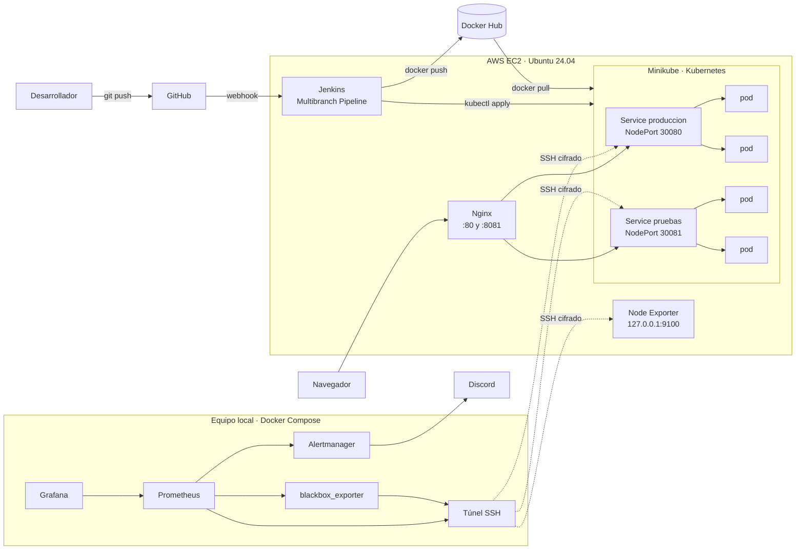
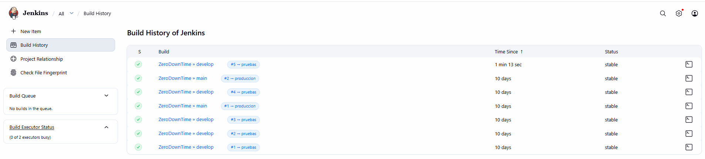
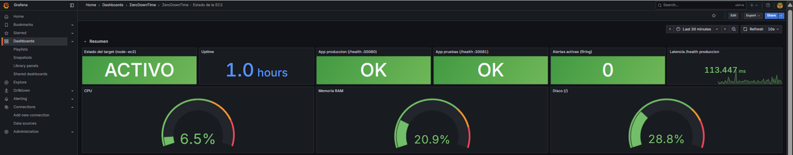
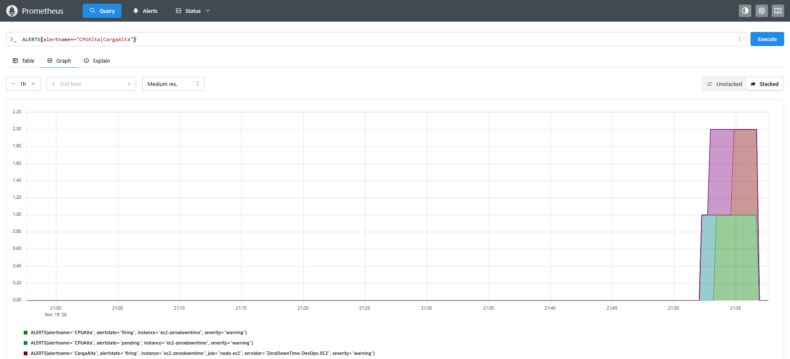
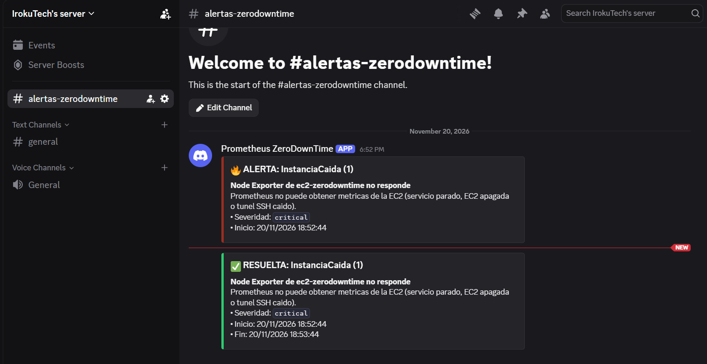

# ZeroDownTime

Plataforma DevOps completa para una aplicación web en Go: contenerización con Docker, CI/CD con Jenkins, despliegue sin cortes en Kubernetes sobre AWS EC2, proxy inverso con Nginx y monitorización con Prometheus, Grafana y alertas en Discord.

Proyecto grupal de la asignatura *DevOps y Cloud Computing*.

## Arquitectura



## Stack

| Área | Tecnologías |
|---|---|
| Aplicación | Go (`net/http`), plantillas HTML, apagado ordenado ante `SIGTERM` |
| Contenedores | Docker (build multi-etapa), Docker Hub |
| CI/CD | Jenkins Multibranch Pipeline, webhook de GitHub |
| Orquestación | Kubernetes (Minikube), Deployments con `RollingUpdate`, Services `NodePort` |
| Infraestructura | AWS EC2 (m7i-flex.large), IP elástica, Security Groups |
| Red | Nginx como proxy inverso |
| Observabilidad | Prometheus, Node Exporter, blackbox_exporter, Grafana, Alertmanager, Discord |

## Estructura del repositorio

```
.
├── main.go, templates/, static/   Aplicación web en Go
├── Dockerfile                     Imagen multi-etapa (golang:1.27-alpine → alpine:3.22)
├── Jenkinsfile                    Pipeline de construcción, publicación, despliegue y verificación
├── k8s/                           Deployment (2 réplicas, sondas, RollingUpdate) y Service (NodePort)
├── infra/nginx/                   Proxy inverso hacia los Services de Kubernetes
├── monitoring/                    Stack de monitorización (Docker Compose)
│   ├── ec2/                       Servicio systemd de Node Exporter para la EC2
│   ├── tunel/                     Contenedor con el túnel SSH hacia la EC2
│   ├── prometheus/                Configuración y reglas de alerta
│   ├── alertmanager/              Rutas y plantilla de notificaciones a Discord
│   ├── blackbox/                  Comprobaciones HTTP de /health
│   └── grafana/                   Fuente de datos y dashboards aprovisionados
└── docs/img/                      Capturas del proyecto
```

## Aplicación

Servidor HTTP en Go que expone:

| Ruta | Descripción |
|---|---|
| `/` | Página web con el pod, el entorno y la versión que atienden la petición |
| `/health` | Estado de la aplicación (sondas de Kubernetes y monitorización) |
| `/info` | JSON con el nombre, el entorno, la versión y el pod |
| `/pod` | Texto plano con el pod que responde (demostración del balanceo) |

Ante un `SIGTERM` termina las peticiones en curso antes de salir, de modo que Kubernetes puede sustituir pods sin cortar respuestas.

## CI/CD

Cada rama tiene su propio entorno, aislado en un namespace:

| Rama | Namespace | NodePort | Acceso vía Nginx |
|---|---|---|---|
| `develop` | `pruebas` | 30081 | `:8081` |
| `main` | `produccion` | 30080 | `:80` |

Flujo: `git push` → webhook de GitHub → Jenkins → `docker build` y `docker push` → `kubectl apply` → `kubectl rollout status` → prueba de humo.

- **Versionado de imágenes:** `rama-build-commit` (por ejemplo, `main-2-503b519`), lo que permite saber qué código hay desplegado y volver atrás con `kubectl rollout undo`.
- **Verificación automática:** tras desplegar, el pipeline comprueba `/health` y espera a que todas las respuestas procedan de la versión nueva.
- **Credenciales:** el token de Docker Hub se guarda en el gestor de credenciales de Jenkins, nunca en el repositorio.
- **Paso a producción:** los cambios se validan en `develop` y llegan a `main` mediante pull request.



## Alta disponibilidad

- **2 réplicas** por entorno; el Service reparte las peticiones entre ellas.
- **`RollingUpdate` con `maxUnavailable: 0` y `maxSurge: 1`:** durante una actualización nunca hay menos de 2 pods disponibles.
- **Sondas de readiness y liveness** sobre `/health`: solo reciben tráfico los pods preparados y los que dejan de responder se reinician.
- **`preStop` y apagado ordenado** para no perder peticiones al retirar un pod.
- **Límites de CPU y memoria** en cada contenedor.

Resultados medidos: al eliminar un pod con tráfico continuo, 120 peticiones correctas y 0 fallidas; durante una actualización de versión en producción, 1159 peticiones sin ningún error.

## Monitorización y alertas

Prometheus y Grafana se ejecutan en el equipo local con Docker Compose. **Node Exporter solo escucha en `127.0.0.1` de la EC2** y Prometheus accede a él a través de un **túnel SSH** que corre como un contenedor más del stack. Así no se abre ningún puerto adicional en el Security Group y el tráfico de métricas viaja cifrado. El mismo túnel permite a blackbox_exporter comprobar `/health` en los dos entornos.

Grafana carga automáticamente la fuente de datos y un panel propio con indicadores de estado, gauges de CPU, memoria y disco, y series temporales de CPU, memoria, red, carga, disco y servicios de systemd.



Reglas de alerta:

| Alerta | Condición | Severidad |
|---|---|---|
| `InstanciaCaida` | Node Exporter no responde (`up == 0`) durante 1 min | critical |
| `AplicacionCaida` | `/health` falla en producción o pruebas durante 1 min | critical |
| `CPUAlta` | CPU > 80 % durante 1 min | warning |
| `MemoriaAlta` | Memoria > 85 % durante 1 min | warning |
| `DiscoLleno` | Disco raíz > 80 % durante 1 min | warning |
| `CargaAlta` | Carga por núcleo > 1,5 durante 2 min | warning |

Todas se han provocado de forma controlada (parada del servicio, `stress-ng`, `fallocate` y escalado a 0 réplicas) para comprobar el ciclo `inactive → pending → firing → resuelta`.



Alertmanager agrupa las alertas y las notifica en Discord, incluida su resolución. Una regla de inhibición evita avisos redundantes: si la instancia está caída, no se notifican sus alertas de severidad *warning*.



### Hallazgo durante las pruebas

La prueba de memoria (92 % de uso en una instancia sin swap) dejó el nodo de Kubernetes en `NotReady` durante aproximadamente un minuto, y la aplicación de producción dejó de responder a pesar de tener 2 réplicas. Al cruzar métricas y logs (`journalctl`, eventos de Kubernetes y el error `leaderelection lost` de `storage-provisioner`) se concluyó que las réplicas protegen frente a la caída de un pod, pero no frente al agotamiento de recursos del único nodo, que además comparte la instancia con Jenkins. Mejoras propuestas: fichero de swap, límite de memoria para Jenkins, alerta temprana al 75 % y, en un entorno real, separar CI y clúster en instancias distintas con varios nodos.

## Seguridad

- El Security Group solo permite SSH (22), Jenkins (8080) y la aplicación (80 y 8081) desde IPs concretas; el 8080 admite además los rangos de webhooks de GitHub.
- Node Exporter no se expone: se accede por túnel SSH.
- Node Exporter se ejecuta con un usuario de sistema sin shell y con opciones de endurecimiento de systemd.
- Ningún secreto se guarda en el repositorio: credenciales en Jenkins y ficheros `.env` locales excluidos por `.gitignore`.

## Puesta en marcha

### Aplicación en local

```bash
docker build -t zerodowntime .
docker run -d -p 8080:8080 zerodowntime
curl http://localhost:8080/health
```

### Stack de monitorización

Requiere Docker y acceso SSH a la EC2.

```bash
cd monitoring
cp env.example .env                                   # IP de la EC2, ruta de la clave y credenciales de Grafana
cp alertmanager/env.discord.example alertmanager/.env.discord   # URL del webhook de Discord
docker compose up -d --build
```

| Servicio | URL |
|---|---|
| Prometheus | http://localhost:9090 |
| Alertmanager | http://localhost:9093 |
| Grafana | http://localhost:3000 |

En la EC2, Node Exporter se instala como servicio con `monitoring/ec2/node_exporter.service`, y Nginx con `infra/nginx/zerodowntime.conf`.

## Equipo

- Andrey Carrera Mosquera
- David Cuenca Guirado
- Yile Ma Ye
